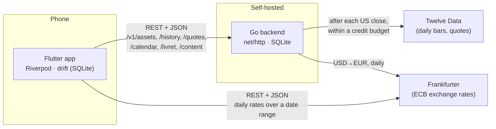
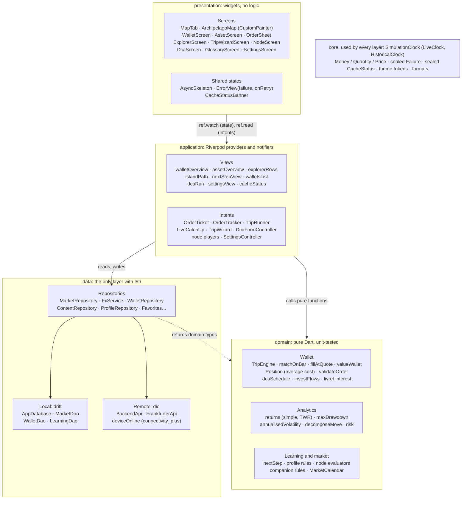
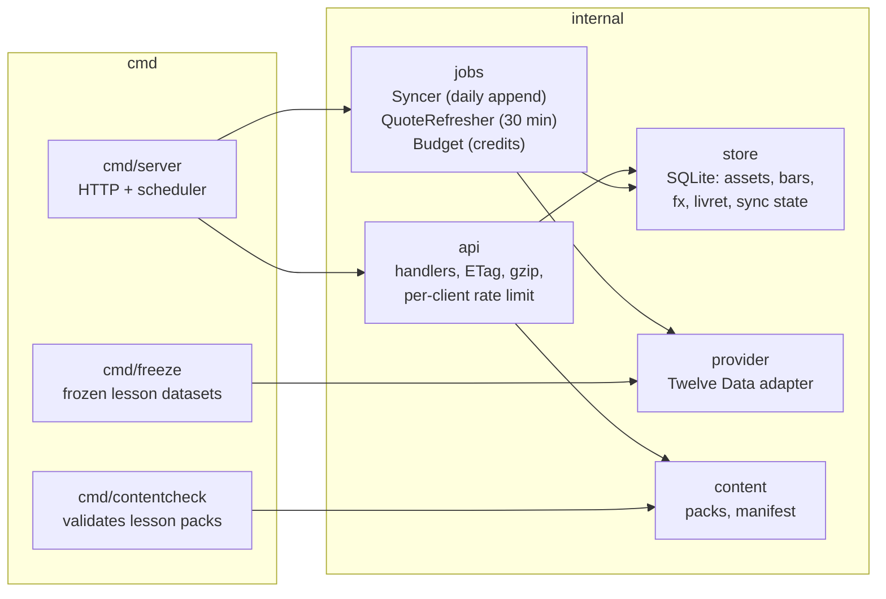
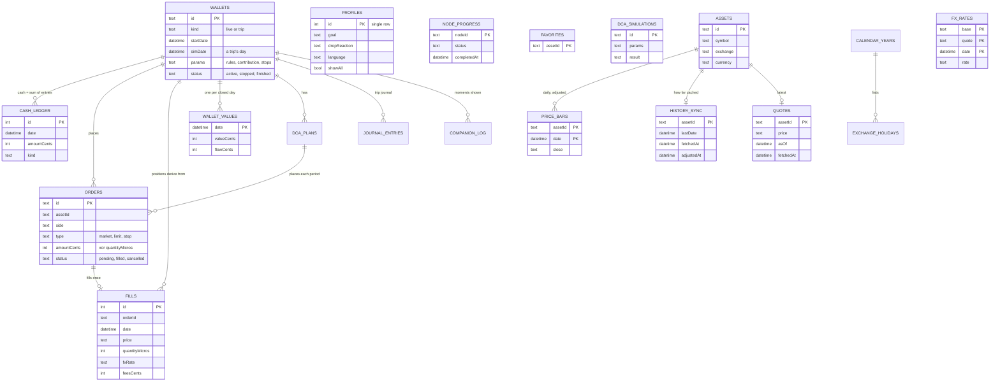
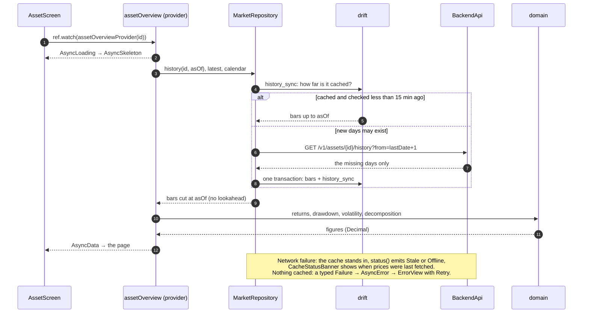

# Architecture

Two programs. The **Flutter app** holds everything the user does and works offline once its cache is
filled. A small **Go backend** sits between the app and the market-data provider: it hides the provider's
key, keeps the whole price history, and spreads the free plan's credits over every user (ADR-004). The app
also calls **Frankfurter** directly for exchange rates (ECB, no key).

## The app: four layers

`presentation → application → domain ← data` (CLAUDE.md rule 1). Each layer knows only the one below it;
the domain knows nobody.

The rules are checked, not only written: `app/test/architecture_test.dart` fails CI when a domain file
imports Flutter, Riverpod or `dart:io` or calls `DateTime.now()`, when anything outside `data/` imports dio,
and when a colour is written anywhere but the theme tokens.

| Folder | Holds | Examples |
|---|---|---|
| `lib/core/` | What every layer shares | `SimulationClock`, `Money`, `Failure`, `CacheStatus`, theme tokens, `Formats` |
| `lib/domain/` | Business rules and calculations, pure functions over immutable values | `trip_engine.dart`, `valuation.dart`, `order_matcher.dart`, `analytics/`, `dca.dart` |
| `lib/data/` | drift tables and DAOs, HTTP clients and DTOs, repositories | `market_repository.dart`, `wallet_repository.dart`, `tables.dart` |
| `lib/application/` | One provider or notifier per screen-level concern | `wallet_providers.dart`, `order_ticket.dart`, `trip_runner.dart` |
| `lib/presentation/` | Screens and widgets, by feature | `features/wallet/`, `features/map/`, `routing/router.dart` |

## The backend

No user data and no accounts: the backend serves the same public market data and lessons to everyone.

## The data the app keeps

Two groups of tables (`app/lib/data/local/tables.dart`, ADR-002). **Cache** tables hold what came from the
network: Settings can clear them, and they come back. **User** tables hold what only the user created; they
never point at a cache table, so clearing the cache cannot break them. Money is stored as integer cents,
quantities as integer millionths, prices and rates as exact decimal strings (ADR-003).

Not drawn: `glossary_state`, `livret_rates` and `livret_ceilings`, `calendar_years`' columns,
`content_packs`. Positions are never stored: they are derived from fills (average cost), so the ledger,
the fills and the daily values are the whole truth. The schema is at version 3; every version ships with a
migration and a test that upgrades a database of each older version (`app/test/drift/`).

## One read, end to end

Opening an asset page: what runs, and where each decision is taken.

## The architecture questions (subject §12)

**Where is the application's state, and why?** The source of truth is the drift database: wallets, orders,
fills, progress, settings. Riverpod providers (`lib/application/`) hold what is derived from it for the
screens (a wallet's valuation, an asset's figures, a lesson's state) and recompute when what they watch
changes. Widgets keep only what belongs to the screen itself: a text field's controller, an animation's
controller. One place to persist, many cheap views, and every view testable without a widget (ADR-001).

**Who decides between the API and the cache?** The repositories, and only they (BRIEF §6.3):
`MarketRepository`, `FxService`, `ContentRepository`. A provider asks for « Apple's history as of this
date »; the repository answers from drift and decides on its own whether a request is due
(ADR-005, [cache.md](cache.md)). The UI never knows where data came from, except through `CacheStatus`.

**Where are the business calculations?** In `lib/domain/`, as pure functions over immutable values, with no
Flutter, no I/O and no clock: valuation, order matching, the trip engine, returns (simple and
time-weighted), drawdown, volatility, the move decomposition, DCA, Livret interest. Time is an argument
(`asOf`), so a function gives the same answer for a live wallet and for a trip in 2008. They carry most of
the unit tests ([tests.md](tests.md)).

**Who is responsible for persistence?** The data layer: `AppDatabase` (drift) and its DAOs, used only
through repositories (`WalletRepository`, `ProfileRepository`…). A trade is one transaction: the order, its
fill and its ledger entries (the amount and the fees) are written together or not at all.

**How do errors and loading reach the screen?** Every failure is typed where it happens: `http.dart` maps
Dio errors to `NetworkFailure`, `RateLimitedFailure`, `NotFoundFailure` or `ServerFailure`, and
`guardStorage` maps database errors to `StorageFailure`; a trip past the cached data throws
`DataUnavailableFailure`. Providers are asynchronous, so Riverpod hands the screen an `AsyncValue`:
loading, data or error. Screens switch on it and use three shared widgets: `AsyncSkeleton` while loading,
`ErrorView` (the failure in words, a Retry that invalidates the provider), and the content. A refresh keeps
the previous data on screen. Staleness is not an error: it travels separately, as the `CacheStatus` stream
behind `CacheStatusBanner`.

**What happens when a widget rebuilds?** Nothing expensive. `build` only watches providers and lays out
what they hold; nothing is fetched in `build`. A provider keeps its value across rebuilds and recomputes
only when something it watches changes or it is invalidated, so a rebuild reuses the last result. State that
must outlive a frame lives in `State` objects (an animation controller belongs to its widget's `State`,
which disposes it) or in a provider. A provider nobody watches anymore is disposed; an action controller that a
screen only reads is kept alive on purpose (M9-9).
