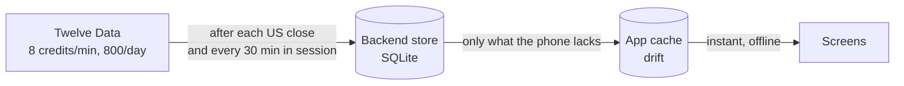

# Cache: persistence, invalidation, refresh

The subject asks for the cache strategy to be explained and justified (§5), and for the app to stay useful
offline, showing when its data was last updated (§6). This page gathers the strategy from ADR-005,
ADR-006 and `docs/BRIEF.md` §6, with the reason behind each rule.

## Two levels, one reason each

**The backend** is the only client of the market-data provider. Two reasons: the provider's key cannot ship
inside an app, and its free plan (8 credits a minute, 800 a day) could not serve each phone on its own
(ADR-004). The backend downloads each asset's history once, from 2000-01-03, then appends each session after
the US close (17:00 New York) one date window, one credit, at a time; its progress is saved after every
window, so a run cut short by the budget or a crash resumes where it stopped. Live quotes are refreshed every
30 minutes during the US session; outside it the API serves the last close and spends nothing. A credit
budget (8 a minute, 700 a day by default) spreads every job over the plan and leaves room for manual calls.
Responses carry an `ETag`, bodies over 1 KB are gzipped, and each client is limited to 120 requests a minute.

**The app** keeps what the user has needed, for two reasons: to answer at once (a screen reads its local
database, then the network only if something is due), and to keep working without a connection. Only the
repositories decide between cache and network (`MarketRepository`, `FxService`, `ContentRepository`); a
provider asks for « Apple's history as of this date » and never knows where the answer came from.

## What the app keeps, and when it asks again

| Data | Fetched when | Kept | Why |
|---|---|---|---|
| Price history | First need: the whole history (about 775 KB of JSON, 195 KB gzipped). Then only the days after the last cached one, at most every 15 min. | Forever | A closed day never changes, so it is downloaded once; asking only for the missing days keeps each refresh to a few hundred bytes. The 15-minute floor stops screens that open one after another from asking again. |
| Re-adjusted history | When the backend's `adjustedAt` differs from the cached one | Replaced | Prices are adjusted for dividends and splits (ADR-004), so a split rewrites the past: that asset's history is dropped and fetched whole, in one transaction, never mixed. |
| Quotes (live wallet) | Expired: 15 min after the fetch while the asset's exchange is open; otherwise at its next open, holidays included | Until replaced | The backend refreshes quotes every 30 min, so 15 min is fresh enough; a closed market's price cannot change before it opens, so nights and weekends cost nothing. |
| Catalogue | Once a day, and when an unknown asset is asked for | Until replaced | It changes rarely; an unknown id is the one sign it changed sooner. |
| Market calendar | Past years once; the current year and later once a day | Forever | A past holiday is fixed; an unscheduled closure can still be announced for this year. |
| Exchange rates (Frankfurter) | First need of a pair: its whole history since 2000 (one request, about 200 KB). Then only new days, at most every 15 min | Forever | ECB reference rates are fixed once published; a weekend takes Friday's rate. |
| Livret A rates | Once a day | Until replaced | They change a few times a year. |
| Lesson packs | Bundled with the app; the manifest is asked at most once a day; a newer version is downloaded and kept only if it reads correctly | Until a newer one | Lessons work offline from the first launch; a bad download can never break them (ADR-006). |

The daily checks of the catalogue and the Livret rates are timed in memory: a relaunch checks once more.

## Rules every read follows

- **Cut at `asOf`.** A read asks « as of this date »: history ends that day, a quote observed after it is
  withheld, an asset listed after it is hidden. A trip in 2008 and the live wallet use the same code, and no
  price from the future can reach a trip (CLAUDE.md rule 3).
- **The device clock times the cache.** Time-to-live and `fetchedAt` use the wall clock; `asOf` only cuts
  what is read.
- **The cache stands in for the network.** A request that fails falls back to what is cached. A typed
  failure reaches the screen only when nothing is cached.
- **User data never depends on the cache.** User tables never reference cache tables, so clearing the cache
  cannot break a wallet (`tables.dart`, ADR-002).

## What invalidates what

| Event | Effect |
|---|---|
| Time passes | The next read past a time-to-live asks again (table above). |
| A session closes | The next history read, 15 min after the last check, asks for the new day. |
| The backend re-adjusts an asset | Its cached history is dropped and fetched whole. |
| A new lesson version is published | Downloaded within a day, kept if it reads. |
| An app update ships a newer bundled pack | The bundle replaces an older cached pack. |
| « Actualiser maintenant » (Settings) | Every price becomes due: the next read of each asks again. Until then, and offline, the cached prices stand, and Settings keeps the time they came. |
| « Vider le cache » (Settings) | Prices, quotes and rates are deleted; wallets, lessons, the catalogue and calendars stay. |

## Offline: a degraded mode, said on screen

`MarketRepository.status()` emits a `CacheStatus`: `Offline(lastUpdated)` when the device has no connection
(`connectivity_plus`), `Stale(lastUpdated)` when it has one but the last price fetch failed and the cache
stood in, `Fresh` otherwise. `CacheStatusBanner` turns the first two into a line above the prices:
« Hors connexion. Tu vois les cours du 7 octobre 2026, 22 h 05. », with Retry
(`docs/screenshots/m9-5-wallet-offline.png`).

What still works offline: the map, every lesson (bundled), wallets, positions and charts, the glossary,
saved simulations, the asset pages and the explorer, a trip moving within its cached history. Placing a
live market order offline queues it for the next session's open, so it never fills at a price that may be
hours old; it fills once back online. A held asset without a cached quote is valued at its last cached close.

How it is checked: `app/test/offline_test.dart` fills the cache online, kills the app, relaunches it with
the network off, and opens every tab and screen (in CI). `docs/qa/offline.md` is the same walk by hand on a
phone in airplane mode; it was run on 2026-10-12 (record in PR #63) and found three bugs, since fixed.

## Measured

- The first view of an asset downloads its whole history: about 775 KB of JSON, sent gzipped as about
  195 KB. Each later refresh brings only the new days.
- A trip moving through cached history makes no request.
- After one session on a phone, Settings read « 29 historiques, 167 390 cours, 21,1 Mo sur l'appareil »:
  the whole catalogue's history since 2000.

## Limits and what could come next

- The backend answers conditional requests (`ETag`, `Last-Modified`); the app does not send them yet. Its
  time-to-live rules and incremental ranges already avoid refetching what it holds.
- Values the app stores (each wallet's daily value) keep the prices they were computed with; after a
  re-adjustment they are not recomputed.
- « Actualiser maintenant » is remembered in memory only: after a relaunch the usual time-to-live rules
  apply again.
- Offline, a trip step that needs a calendar year never fetched stops with a network error rather than
  « Pas de données disponibles »: the trip stays where it was either way.
- There is no automatic eviction: the cache is bounded by the catalogue (29 assets since 2000, about
  21 MB), and « Vider le cache » empties it.
